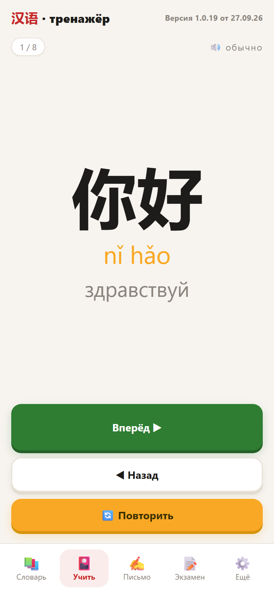

# 汉语 · Trainer — Language Trainer

A mobile-friendly PWA for learning foreign words: Chinese characters, English/Turkish words and Arabic text. Russian interface, four learning languages. Installable on a phone and works offline.

**[Open the app](https://refolit.github.io/Lang-trainer/)**



## Languages

| Code | Language | Writing screen |
|---|---|---|
| `zh` | 中文 — Chinese | stroke order (HanziWriter): trace or assemble from parts |
| `en` | English | letter cubes (film strip / fanfare) |
| `tr` | Türkçe — Turkish | keyboard: whole word / letter-by-letter / build from letters |
| `ar` | العربية — Arabic (RTL) | keyboard: whole word / letter-by-letter / build from letters |

Each language has its own cards, tags and statistics; the language is switched in **More → Settings → Language**. Chinese and English cards also get a transcript row (pinyin / IPA).

## Features

- **Dictionary** — words with translation, pinyin/IPA, tags, audio; search, filters (all / ★ / learned / custom), sorting, grouping by month, trash with restore, batch input of many words, export to TXT.
- **Learn (Изучение)** — flashcards with spaced repetition (Leitner boxes, intervals in days), direction "foreign → Russian" / "Russian → foreign" / mixed, adjustable card sizes, "browse" mode with audio, "Write this" button.
- **Write (Письмо)** — Chinese: animated stroke order, trace or assemble from components; other languages: keyboard, letter-by-letter check or build from letters. Hints after mistakes, word order, audio.
- **Exam (Экзамен)** — true/false, multiple choice, tones, "tones → pinyin", matching pairs, writing; results and a list of mistakes.
- **Statistics** — totals, memory boxes, activity calendar, words/history charts, best streaks.
- **Prayers (Молитвы)** — ready-made Arabic sets (Du'a Qunut, Muhammadiya lessons 1–10) that can be added to the dictionary with audio.
- **Audio** — Google TTS (regional voices, cached for offline), built-in speech synthesis as a fallback, own MP3 recordings per word.
- **Design** — 8 themes (light, dark, sepia, blue, navy, forest, graphite, plum), two colour modes (5 semantic colours / multicolour), pill navigation, 3D buttons, RTL layout for Arabic.
- **Data** — JSON import/export for all languages at once, "wipe everything", TTS cache cleanup.

## Accounts and cloud sync

- Sign-in by email + password (Supabase Auth), a display name stored in the cloud profile.
- **Sync** with Supabase: cards, progress, settings, statistics and audio (Storage) are merged by stable card ids; conflicts are resolved by content/progress signatures; the sync journal shows what was pushed and pulled.
- Works fully offline: without an account everything is kept on the device only.

## Admin panel

Available only to users listed in the `admins` table (checked server-side via `is_admin()`):

- **Users** — name, email, number of cards, number of syncs, last sync; view and edit another user's dictionary.
- **User activity** (v1.12.0) — live feed of events via Supabase Realtime: app open, session start, work activity, sync started/completed/changed/error; summary per user (last seen, last activity, last sync, events today / 7 days, sessions in 30 days), unread badge.

## How to install on your phone

1. Open the app in your phone's browser:
   `https://refolit.github.io/Lang-trainer/`
2. Choose **Add to Home Screen** (Android Chrome / iOS Safari).
3. The app appears as a regular icon and works without internet.

## Built with

- [HanziWriter 3.6](https://github.com/chanind/hanzi-writer) — animated character writing.
- [hanzi-writer-data 2.0.0](https://www.npmjs.com/package/hanzi-writer-data) — character stroke data (58 characters are embedded in the offline build).
- [pinyin-pro 3.29.4](https://github.com/zh-lx/pinyin-pro) — pinyin generation.
- [Supabase](https://supabase.com) — auth, Postgres, Storage, Realtime.
- [Supabase JS](https://github.com/supabase/supabase-js) — client library.

## Project structure

| File | Purpose |
|---|---|
| `index.html` | the whole app: HTML, CSS, JS (single source of truth) |
| `sw.js` | service worker, cache name is tied to the app version |
| `build-offline.mjs` | builds `hanzi-trainer-offline <version>.html` with libraries and stroke data embedded |
| `supabase/*.sql` | database scripts, run in Supabase SQL Editor in phase order |
| `PROJECT_NOTES.md` | full project documentation and change history |
| `SYNC_PLAN.md` | cloud sync design notes |
| `zh_ru_manual_top5000.json`, `en_ru_manual_top5000.json` | manual translation dictionaries |
| `hanzi_decomp.json` | character decomposition data |

## Development

The app is one HTML file with no build step for the web version. To check the inline script syntax:

```bash
node -e "const fs=require('fs');const h=fs.readFileSync('index.html','utf8');fs.writeFileSync('.tmp-check.js',[...h.matchAll(/<script(?![^>]*src=)[^>]*>([\s\S]*?)<\/script>/g)].map(m=>m[1]).join('\n;\n'))" && node --check .tmp-check.js && rm .tmp-check.js
```

To rebuild the offline single file (reads `APP_VERSION` from `index.html`):

```bash
node build-offline.mjs "D:/! MyProjects/Github/Lang trainer/Lang trainer"
```

Then add `!hanzi-trainer-offline <version>.html` to `.gitignore` so the file is tracked.

### Database

Run the SQL scripts from `supabase/` in Supabase → SQL Editor, in order:

1. `phase2.sql`, `phase2-storage.sql`, `phase2-storage-fix.sql`
2. `phase8-sync-fix.sql`, `phase9-sync-log.sql`
3. `phase10-cards-composite-key.sql`
4. `phase11-admin.sql` — admin role, `is_admin()`, admin RPCs (insert your own user id at the bottom)
5. `phase12-user-activity.sql` — activity events table, RLS, Realtime and admin RPCs (requires `phase11-admin.sql`)

All scripts are idempotent and can be re-run safely.

## Versioning

The version lives in three places and they must always match:

1. `APP_VERSION` in `index.html`;
2. `VERSION` in `sw.js`;
3. the `VERSIONS` array in `index.html` (shown by tapping the version number).

Rule: a small fix bumps the third digit, a noticeable change the second, a major rework the first.